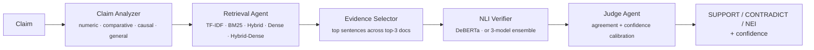

# Adaptive Multi-Agent System for Scientific Claim Verification


Given a scientific claim, this system retrieves evidence from a corpus of biomedical abstracts and decides whether
the evidence **SUPPORTS** the claim, **CONTRADICTS** it, or provides **Not Enough Information (NEI)** - together with
a calibrated confidence score.

Instead of a single end-to-end model, the task is decomposed across specialized agents (retrieval, evidence
selection, NLI verification, and a Judge that calibrates confidence), so each stage can be measured and swapped
independently.

📄 **Paper:** [report/scientific_claim_verification_paper_FINAL.pdf](report/scientific_claim_verification_paper_FINAL.pdf)

## Key Results

| Finding | Result |
|---|---|
| Best retriever (dense, `all-MiniLM-L6-v2`) | **Recall@1 0.689** · R@5 0.896 · R@10 0.919 (vs. 0.605 R@1 for TF-IDF) |
| Fine-tuned DeBERTa NLI (gold evidence) | **71.3% accuracy**, 0.682 macro-F1 |
| Judge Agent (confidence calibration) | Zero-shot pipeline accuracy **46.0% → 49.0%**, macro-F1 0.442 → 0.471 |
| Retrieval bottleneck | Fine-tuned model drops 25–35 pts end-to-end → retrieval, not the verifier, is the limiting stage |
| Multi-agent disagreement | Reliably flags ambiguous claims (best NEI-F1 0.564 under majority vote) |

## Architecture



- **Claim Analyzer** - categorizes the claim type, which informs how the Judge scores confidence.
- **Retrieval Agent** - five interchangeable retrievers, from sparse keyword matching to dense semantic search.
- **Evidence Selector** - ranks sentences across the top-3 retrieved abstracts rather than only the first.
- **NLI Verifier** - single DeBERTa (zero-shot or fine-tuned), or a multi-agent ensemble of DeBERTa, BART-MNLI, and MiniLM with majority / confidence-weighted voting.
- **Judge Agent** - penalizes disagreement between sentence- or model-level predictions; anything below 0.40 confidence is downgraded to NEI.

## Retrieval Benchmark

| Method | Recall@1 | Recall@5 | Recall@10 |
|---|---|---|---|
| TF-IDF | 0.605 | 0.841 | 0.885 |
| BM25 | 0.590 | 0.783 | 0.826 |
| Hybrid (TF-IDF + BM25) | 0.632 | 0.836 | 0.882 |
| **Dense (Sentence-BERT)** | **0.689** | **0.896** | **0.919** |
| Hybrid Dense (all three) | 0.670 | 0.879 | 0.919 |

<sub>SciFact, 866 claim–document pairs.</sub>

## Quick Start

```bash
git clone https://github.com/Akshayaamahesh/scientific_claim_verification.git
cd scientific_claim_verification
python3 -m venv venv && source venv/bin/activate
pip install -r requirements.txt

# 1. Build the processed SciFact dataset
python preprocessing/build_scifact_dataset.py

# 2. Verify a single claim
python main.py --claim "Smoking causes lung cancer." --retriever dense
python main.py --claim "Smoking causes lung cancer." --retriever dense --multi   # multi-agent mode
```

Available retrievers: `tfidf`, `bm25`, `hybrid`, `dense`, `hybrid_dense`.

## Reproducing the Experiments

```bash
python main.py --evaluate --retriever dense --n 100     # full pipeline evaluation
python retrieval/evaluate_retrieval.py                  # 5-way retrieval comparison
python evaluation/ablation_study.py                     # component ablation
python evaluation/error_analysis.py                     # error breakdown by class / claim type
python evaluation/evaluate_multi_agent.py               # single- vs multi-agent
```

### Fine-tuning (optional)

A fine-tuned checkpoint config is provided in `models/nli-finetuned/`. To retrain (≈2 h on CPU):

```bash
python train.py --epochs 5 --batch_size 4 --lr 1e-5
```

Then set `NLI_MODEL = "models/nli-finetuned"` in [`config.py`](config.py). The fine-tuned model performs best on
gold evidence; the zero-shot model (default) is more robust inside the full retrieval pipeline.

## Project Structure

```
├── agents/          # Claim Analyzer, NLI Verifier, Judge, Multi-Agent Verifier
├── retrieval/       # TF-IDF, BM25, Hybrid, Dense, Hybrid-Dense retrievers + evaluation
├── evidence/        # Sentence-level evidence selector
├── evaluation/      # Ablation, error analysis, pipeline & multi-agent evaluation
├── preprocessing/   # SciFact dataset construction
├── models/          # Fine-tuned NLI model config
├── report/          # Progress reports and final paper
├── config.py        # Hyperparameters and paths
├── main.py          # CLI entry point
└── train.py         # NLI fine-tuning
```

## Future Work

- **Pipeline-aware training** - fine-tune the verifier on *retrieved* rather than gold evidence to close the distribution gap.
- **Cross-encoder re-ranking** - second-stage re-ranker targeting Recall@1 > 0.80.
- **Disagreement-triggered re-retrieval** - fetch more evidence when agents disagree instead of defaulting to NEI.

## Team

Akshayaa Mahesh · Meghana Raghavendra · Dhruthi Rajesh - *Foundations of AI, Northeastern University*

## References

- Wadden et al. (2020). *Fact or Fiction: Verifying Scientific Claims.* EMNLP.
- Reimers & Gurevych (2019). *Sentence-BERT.* EMNLP.
- Besrour et al. (2025). *SQuAI: Scientific Question-Answering with Multi-Agent RAG.* CIKM.
- Evans et al. (2023). *MSVEC: A Multidomain Testing Dataset for Scientific Claim Verification.*
