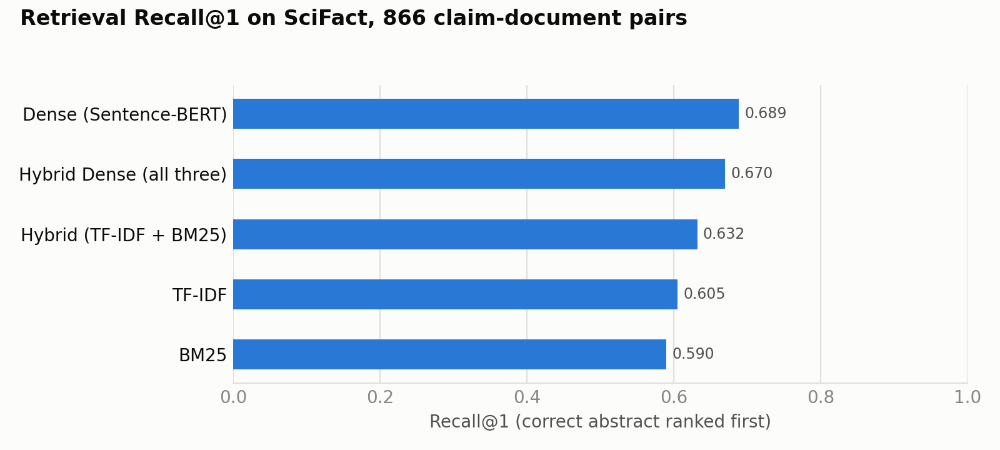
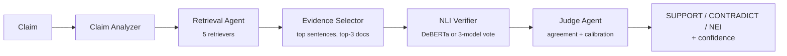

<div align="center">

# SciFact

**Does the research actually back this claim?**

A multi-agent scientific claim verifier. It retrieves biomedical abstracts, selects the sentences that matter, runs natural language inference on them, and returns `SUPPORT`, `CONTRADICT` or `NEI` with a calibrated confidence.


[Paper](report/scientific_claim_verification_paper_FINAL.pdf) · [Quick start](#quick-start) · [Results](#results)

</div>



> **Research prototype.** Built for Foundations of AI at Northeastern University. Not a medical
> or fact-checking authority. Verdicts need human review.

## Contents

- [What it does](#what-it-does)
- [See it work](#see-it-work)
- [How a verdict is decided](#how-a-verdict-is-decided)
- [Results](#results)
- [Quick start](#quick-start)
- [Reproducing the experiments](#reproducing-the-experiments)
- [Project structure](#project-structure)
- [Limitations](#limitations)
- [Team](#team)
- [References](#references)

## What it does

AI tools that summarize scientific literature are often confidently wrong: they say a paper supports a claim when it contradicts it, or when it never addresses it at all. SciFact splits verification into separate, measurable steps so each one can be tested and swapped on its own.

Give it a claim:

1. **Analyze.** The Claim Analyzer labels the claim as numeric, comparative, causal or general.
2. **Retrieve.** One of five retrievers (TF-IDF, BM25, Hybrid, Dense, Hybrid Dense) finds candidate abstracts from the 535-document SciFact corpus.
3. **Select evidence.** The Evidence Selector ranks sentences across the top three abstracts, not just the first.
4. **Verify.** An NLI model (DeBERTa, zero-shot or fine-tuned) scores each sentence against the claim. In multi-agent mode, DeBERTa, BART-MNLI and MiniLM vote.
5. **Judge.** The Judge Agent turns agreement into a confidence score and downgrades anything below 0.40 to `NEI`.

## See it work

```bash
python main.py --claim "Smoking causes lung cancer." --retriever dense
```

```text
Claim: Smoking causes lung cancer.
Retriever : DENSE
Mode      : Single-Agent

Step 1 - Retrieved 5 documents
  Top doc ID : 16422880
  Top score  : 0.5649

Step 2 - Selected 3 evidence sentences
  • [doc 16422880, score 0.350] OBJECTIVE To assess the effects of smoking reduction on lung cancer incidence.
  • [doc 16422880, score 0.275] CONCLUSION Among individuals who smoke 15 or more cigarettes per day, smoking reduction by 50% signi...
  • [doc 16422880, score 0.217] MAIN OUTCOME MEASURE Incident primary lung cancer cases assessed by record linkage with the National...

Step 3 - NLI Verifier
  Raw label      : NEI
  Raw confidence : 0.7214

Step 4 - Judge Agent
  Final label      : NEI
  Final confidence : 0.7117
  Disagreement     : 0.0135
  Claim type       : causal

  VERDICT: NEI  (confidence: 0.7117)
```

The verdict is `NEI`, and that is the correct call for this corpus. The closest abstract studies smoking *reduction*, not whether smoking causes cancer, so the evidence does not settle the claim either way.

**Disagreement as a signal.** For *"Vitamin C reduces the duration of cold symptoms"*, the three multi-agent models split completely: DeBERTa said NEI, BART said SUPPORT and MiniLM said CONTRADICT. Agreement fell to 33%, and the Judge downgraded the result to `NEI` at 0.21 confidence instead of forcing a majority vote.

## How a verdict is decided



- **Sentence level first.** Each evidence sentence gets its own NLI label and confidence.
- **Disagreement lowers confidence.** If sentence predictions (or the three models) disagree, the Judge penalizes confidence using the agreement ratio and the spread of confidence scores.
- **Thresholds.** Above 0.70 is high confidence. Below 0.40 is downgraded to `NEI`. Both live in [`config.py`](config.py).
- **Unanimous votes are boosted**, split votes are penalized.

## Results

All numbers are from the [final paper](report/scientific_claim_verification_paper_FINAL.pdf). SciFact after deduplication: 866 claim-document pairs (368 SUPPORT, 194 CONTRADICT, 304 NEI), stratified 80/20 split.

**Retrieval**

| Method | Recall@1 | Recall@5 | Recall@10 |
| --- | --- | --- | --- |
| TF-IDF | 0.605 | 0.841 | 0.885 |
| BM25 | 0.590 | 0.783 | 0.826 |
| Hybrid (TF-IDF + BM25) | 0.632 | 0.836 | 0.882 |
| **Dense (Sentence-BERT)** | **0.689** | **0.896** | **0.919** |
| Hybrid Dense (all three) | 0.670 | 0.879 | 0.919 |

**Ablation** (zero-shot NLI, 100 dev examples)

| Configuration | Accuracy | Macro F1 |
| --- | --- | --- |
| Gold abstract + NLI (no retrieval) | 0.460 | 0.452 |
| TF-IDF + NLI (no Judge) | 0.460 | 0.442 |
| **TF-IDF + NLI + Judge (full system)** | **0.490** | **0.471** |
| Hybrid + NLI + Judge | 0.450 | 0.408 |

**Key findings**

| Finding | Result |
| --- | --- |
| Fine-tuned DeBERTa on gold evidence | 71.3% accuracy, 0.682 macro F1 (epoch 4 of 5) |
| Same model inside the full pipeline | 33 to 45%: retrieval, not the verifier, is the bottleneck |
| Judge Agent | +3.0 points accuracy over the same pipeline without it |
| Multi-agent majority vote | Best NEI F1 (0.564), but no gain in overall macro F1 |

## Quick start

Needs **Python 3.9+** and **git**.

```bash
git clone https://github.com/Akshayaamahesh/SciFact.git
cd SciFact
python3 -m venv venv && source venv/bin/activate
pip install -r requirements.txt

python preprocessing/build_scifact_dataset.py
python main.py --claim "Smoking causes lung cancer." --retriever dense
```

The first run downloads `all-MiniLM-L6-v2` and `cross-encoder/nli-deberta-v3-small` from Hugging Face.

**Options**

| Flag | Values | Default |
| --- | --- | --- |
| `--claim` | the claim to verify | |
| `--retriever` | `tfidf`, `bm25`, `hybrid`, `dense`, `hybrid_dense` | `hybrid_dense` |
| `--multi` | run the three-model verifier | off |
| `--evaluate` | score the pipeline on the dev set | off |
| `--n` | number of dev examples with `--evaluate` | 50 |

## Reproducing the experiments

```bash
python main.py --evaluate --retriever dense --n 100     # full pipeline
python retrieval/evaluate_retrieval.py                  # 5-way retrieval comparison
python evaluation/ablation_study.py                     # component ablation
python evaluation/error_analysis.py                     # errors by class and claim type
python evaluation/evaluate_multi_agent.py               # single vs multi-agent
```

<details>
<summary>Fine-tuning the NLI model</summary>

About 2 hours on CPU. DeBERTa was trained on CPU because of numerical instability on Apple MPS.

```bash
python train.py --epochs 5 --batch_size 4 --lr 1e-5
```

Then set `NLI_MODEL = "models/nli-finetuned"` in [`config.py`](config.py). The fine-tuned model is best on gold evidence. The zero-shot default is more robust inside the full pipeline.

</details>

## Project structure

```
├── agents/          # Claim Analyzer, NLI Verifier, Judge, Multi-Agent Verifier
├── retrieval/       # TF-IDF, BM25, Hybrid, Dense, Hybrid Dense + evaluation
├── evidence/        # Sentence-level evidence selector
├── evaluation/      # Ablation, error analysis, pipeline and multi-agent evaluation
├── preprocessing/   # SciFact dataset construction
├── models/          # Fine-tuned NLI model config
├── report/          # Progress reports and final paper
├── config.py        # Hyperparameters and paths
├── main.py          # CLI entry point
└── train.py         # NLI fine-tuning
```

## Limitations

<details>
<summary>Show all limitations</summary>

- **CONTRADICT is the hardest class.** Pipeline accuracy on CONTRADICT is 14.3%, and its F1 peaks at 0.424 even with gold evidence.
- **Distribution shift.** The fine-tuned model was trained on gold evidence but runs on retrieved evidence, which costs 25 to 35 points end to end.
- **Overconfidence.** 14 of 55 errors in the full system were made with confidence above 0.60.
- **Conservative bias.** 55% of errors are SUPPORT or CONTRADICT predicted as NEI, mostly when the right evidence was not retrieved.
- **Claim types.** Comparative claims are hardest (20.0% accuracy), then causal (33.3%), general (44.4%) and numeric (52.6%).
- **Small corpus.** 535 abstracts. Results may not hold for larger collections where retrieval is harder.
- **Multi-agent voting** does not reliably beat a single model on accuracy. Its value is the uncertainty signal.

</details>

**Next steps:** pipeline-aware training on retrieved evidence, a cross-encoder re-ranker targeting Recall@1 above 0.80, and re-retrieval triggered by agent disagreement.

## Team

| Name |
| --- |
| Akshayaa Mahesh |
| Meghana Raghavendra |
| Dhruthi Rajesh |

*Foundations of AI, Northeastern University.*

## References

- Wadden et al. (2020). *Fact or Fiction: Verifying Scientific Claims.* EMNLP. Dataset: SciFact.
- Reimers and Gurevych (2019). *Sentence-BERT.* EMNLP.
- Besrour et al. (2025). *SQuAI: Scientific Question-Answering with Multi-Agent RAG.* CIKM.
- Evans et al. (2023). *MSVEC: A Multidomain Testing Dataset for Scientific Claim Verification.* MobiHoc.
- Wolf et al. (2020). *Transformers: State-of-the-Art Natural Language Processing.* EMNLP.
